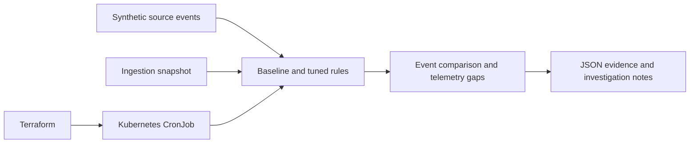

# Kubernetes and Terraform Security Lab

A learning project by Lormensky Jean. Practice Terraform changes, Kubernetes workload security, and RBAC on a disposable local cluster.

## Status

The Python detection workbench runs locally with no third party packages. Twelve tests pass, including adversarial near matches, exception expiry, a known false negative, and missing telemetry. Terraform 1.14.0 validates the Kubernetes resources with provider 2.37.1.

A GitHub Actions workflow builds the image, creates a disposable kind cluster, applies Terraform, and exercises the controls. See the [validation record](docs/validation.md) for execution status rather than assuming that a workflow file proves a successful deployment.

## Start here

```bash
python3 -m unittest discover -s tests -v
python3 -m workbench --source examples/evaluable.json --ingested examples/evaluable.json
```

[Workbench walkthrough and practice tasks](docs/workbench.md) | [Actual replay report](reports/evaluable.json)

The complete fixture replay removes four benign alerts and preserves four malicious alerts. Both rule versions miss malicious activity from a trusted network. A separate outage fixture demonstrates missing and malformed events. These are synthetic fixture results, not production effectiveness claims.



## What this version contains

Terraform manages a restricted namespace, a dedicated service account without a mounted API token, two nonroot demo pods with resource limits, and an observer role that cannot read secrets. The local cluster is created separately with kind, keeping cluster bootstrap separate from the Kubernetes provider.

The baseline demo prints a heartbeat. A suspended CronJob runs the containerized detection workbench on demand. See [the workbench guide](docs/workbench.md#kubernetes-execution) for image build/load instructions before running a Job. It has no public endpoint. It does not install Falcon, Splunk, a CNI, or network policies. The workbench Python base image is digest pinned. The heartbeat image uses a version tag, and the local workbench image uses a lab tag. This is not a fully immutable production release. Pod Security labels follow the cluster's current policy version; pin that version when pinning a cluster release.

## Prerequisites

Install Docker with a running engine, kind, kubectl, and Terraform 1.6 or newer (below 2.0). Review official installation instructions rather than executing an unreviewed installer. This lab creates no cloud resources.

## Run

```bash
kind create cluster --name security-lab
kubectl --context kind-security-lab cluster-info
cd terraform
terraform init
terraform fmt -check
terraform validate
terraform plan -out=lab.tfplan
terraform apply lab.tfplan
kubectl --context kind-security-lab -n security-lab rollout status deployment/lab-app
kubectl --context kind-security-lab -n security-lab logs deployment/lab-app --tail=5
```

Review the plan before applying. The provider lockfile is committed. Update it deliberately after reviewing provider changes. Never commit state files, saved plans, or kubeconfig.

## Verify the controls

```bash
# Expected: yes
kubectl --context kind-security-lab auth can-i list pods --namespace security-lab --as=lab-observer
# Expected: no
kubectl --context kind-security-lab auth can-i get secrets --namespace security-lab --as=lab-observer
# Expected: 65532
kubectl --context kind-security-lab -n security-lab exec deployment/lab-app -- id -u
# Expected: permission denied or read-only filesystem
kubectl --context kind-security-lab -n security-lab exec deployment/lab-app -- touch /should-fail
# Expected: no service account token mounted
kubectl --context kind-security-lab -n security-lab exec deployment/lab-app -- sh -c 'test ! -e /var/run/secrets/kubernetes.io/serviceaccount/token && echo token-not-mounted'
```

The negative write test is expected to exit nonzero. Impersonation checks use the lab administrator context; they do not create a login credential for lab-observer. Save actual outputs in docs/validation.md. Do not mark checks passed based on expected results alone.

## Learning sequence

1. Run the workbench tests, inspect the per-event comparison, and explain the known miss.
2. Deploy the baseline and explain every resource in the plan.
3. Change replicas, inspect the diff, then restore the baseline with Terraform.
4. Test RBAC and Pod Security admission with disposable negative cases.
5. Add Kubernetes audit logging with secret bodies excluded. Capture an exec event and a denied API request.
6. Write and test Splunk detections against those events. Document ingestion, false positives, and missing telemetry.
7. Add optional Falcon coverage checks only with authorized tenant access and appropriate licensing. Keep credentials outside Git.

[Validation record](docs/validation.md) | [Engineering notes](docs/engineering-notes.md)

## Cleanup

```bash
cd terraform
terraform destroy
kind delete cluster --name security-lab
```

Destroy the Terraform resources before removing the cluster.

## References

- [kind quick start](https://kind.sigs.k8s.io/docs/user/quick-start/)
- [Terraform Kubernetes provider](https://registry.terraform.io/providers/hashicorp/kubernetes/2.37.0/docs)
- [Pod Security Standards](https://kubernetes.io/docs/concepts/security/pod-security-standards/)
- [Kubernetes RBAC](https://kubernetes.io/docs/reference/access-authn-authz/rbac/)
